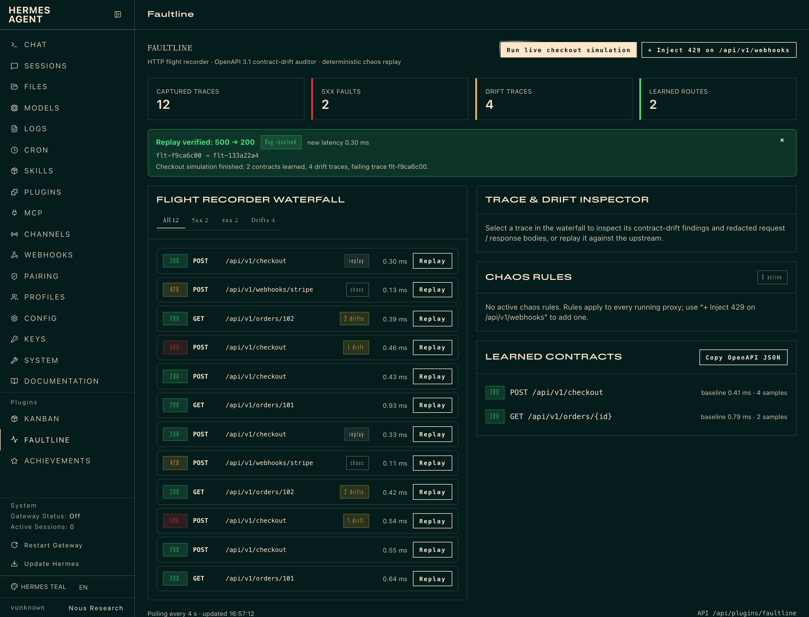
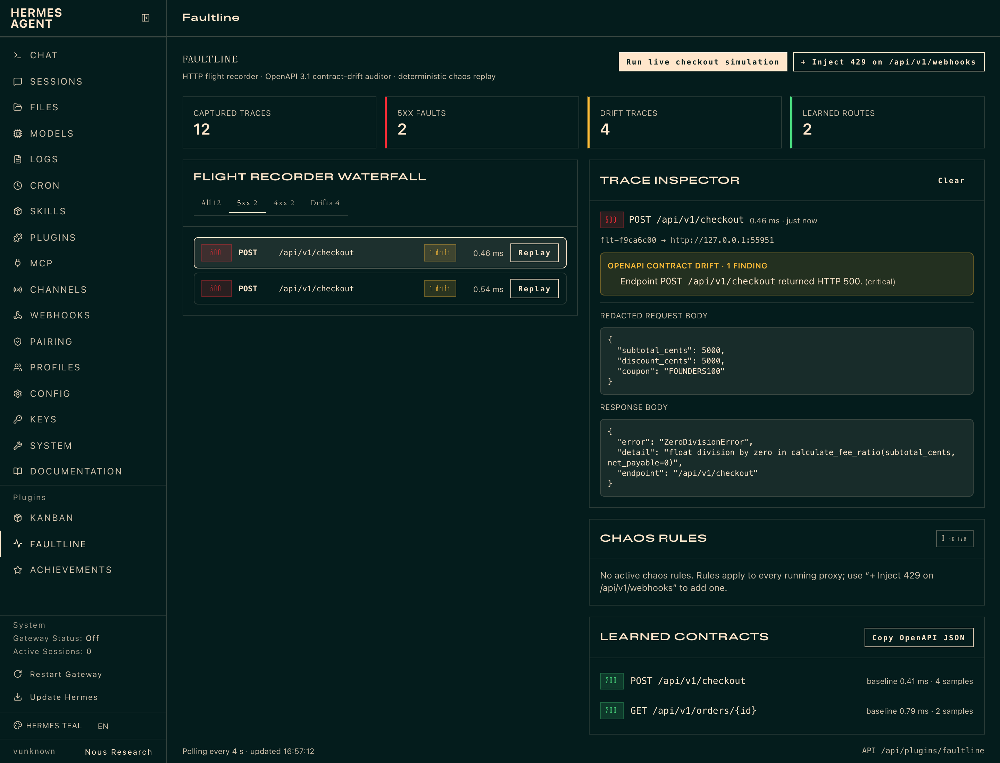

# Faultline (`faultline`)

**Local API flight recorder, OpenAPI 3.1 contract drift detector, and deterministic chaos replay studio for Hermes Agent.**

When you debug an HTTP service with Hermes, the agent usually can't see the traffic. You copy `curl` output into chat, it guesses, you re-run by hand. Faultline gives Hermes the ground truth:

1. **Record.** Hermes starts a reverse proxy on `127.0.0.1` in front of your service. Every request and response is captured to a local SQLite database. Auth headers (`Authorization`, `Cookie`, `X-Api-Key`, …) and secret JSON fields (`password`, `api_key`, `access_token`, …) are redacted *before* anything is written.
2. **Learn the contract.** The first healthy `2xx` response for each route (IDs normalised to `{id}`) becomes the baseline schema. Later responses are checked against it and flagged as `type_mismatch`, `missing_required_field`, `server_error_5xx` or `latency_regression`. The learned contract exports as an OpenAPI 3.1 document.
3. **Break it on purpose.** Chaos rules inject `429`/`5xx` status codes, delay a request before forwarding it, or return truncated JSON on matching routes, so you can see how clients and webhooks behave under failure.
4. **Prove the fix.** After Hermes patches the code, `faultline_replay` re-sends the exact captured failing request and reports the transition (`500 -> 200`), the latency delta, and any drift that remains.

That loop needs live state, a real proxy and a database, so it can't be done with a prompt or skill alone.

---

## Hermes surfaces used

| Surface | What Faultline registers |
| :--- | :--- |
| **Tools** | `faultline_proxy`, `faultline_traces`, `faultline_replay`, `faultline_contract`, `faultline_chaos`, `faultline_simulate` |
| **Middleware** | `tool_execution`: times Faultline's own tool calls and adds `middleware_latency_ms` to their result (other tools pass through untouched) |
| **Hooks** | `post_tool_call`, `on_session_start`: emit `plugin.faultline.*` events |
| **Slash command** | `/faultline [status \| simulate \| replay <trace_id>]` |
| **CLI** | `hermes faultline [status \| simulate \| replay <trace_id> \| contracts]` |
| **Skill** | `faultline:faultline-studio`: the record → audit → chaos → replay workflow |
| **Dashboard API** | `dashboard/plugin_api.py` → `/api/plugins/faultline/{status,traces,replay,contracts,chaos,simulate}`, shared by the Desktop and web-dashboard UIs |
| **Web dashboard tab** | `dashboard/dist/index.js`: a **Faultline** tab in `hermes dashboard` (`http://127.0.0.1:9119/faultline`) with stat tiles, the filterable waterfall, trace inspector with drift findings, replay, chaos rules, and the learned OpenAPI contract (copy as JSON) |
| **Hermes Desktop** | `desktop/plugin.js`: a `/faultline` Studio page + sidebar entry, a live waterfall pane, a status-bar chip, two ⌘K commands, and an inline `::faultline-trace{id="flt-…"}` card with a Replay button |

## Settings

Set under `plugins.entries.faultline.settings` in `config.yaml`, or in the Desktop Plugins tab.

| Key | Default | Effect |
| :--- | :--- | :--- |
| `latency_spike_threshold_ms` | `400` | Any captured response slower than this is flagged `latency_regression` (in addition to the relative check: >4× and >200 ms over the learned baseline). `0` disables the absolute check. |
| `auto_redact_headers` | `true` | Mask auth/cookie/API-key headers before persisting. Secret JSON body fields are always redacted. |
| `max_body_chars` | `16384` | Request/response bodies longer than this are truncated in storage (minimum 256). |
| `allow_local_replay` | `false` | Let `faultline_replay` re-send captured requests to loopback and private-network upstreams, i.e. your local service under test. Off by default, so replay reaches public hosts only until you switch it on. Link-local and cloud-metadata addresses are refused whatever the setting. `faultline_simulate`'s built-in service is exempt: the plugin starts it itself. |

---

## Install

```bash
hermes plugins install faultline          # once listed in the catalog
hermes plugins enable faultline
```

For local development, symlink a checkout into your plugins folder:

```bash
ln -s "$PWD" ~/.hermes/plugins/faultline
hermes plugins enable faultline
```

Both halves start **off**, as for every plugin: the agent half until `hermes plugins enable faultline` (then restart the gateway), the Desktop half until you flip its switch in **Capabilities → Plugins** (one row, two switch columns). The web-dashboard tab appears in `hermes dashboard` as soon as the agent half is enabled.

## Screenshots

Captured from the Faultline tab in `hermes dashboard`.






## Quick start

Ask Hermes something like:

> My checkout service on :8000 is returning 500s for some coupons. Put Faultline in front of it and find out why.

Hermes calls `faultline_proxy(action="start", target_url="http://127.0.0.1:8000")` and gets back a `proxy_url` (e.g. `http://127.0.0.1:53817`). Point your client or frontend at that URL. Hermes then inspects failures with `faultline_traces(status_filter="5xx")` and schema drift with `faultline_traces(status_filter="drifted")`, fixes the code, and verifies with `faultline_replay(trace_id="flt-…")`. Replaying against a service on `127.0.0.1` needs `allow_local_replay: true` in the plugin settings; it is off by default (see [Settings](#settings)).

### Self-contained demo (no service needed)

```bash
python3 demo_faultline.py        # or: /faultline simulate, or: hermes faultline simulate
```

This starts a throwaway checkout microservice and a Faultline proxy on loopback, then:
- captures baseline calls and learns two route contracts;
- captures a `500 ZeroDivisionError` from a 100% discount coupon on `POST /api/v1/checkout`;
- flags drift on `GET /api/v1/orders/102`: `total_cents` came back as a string, and `currency` is missing;
- triggers a `429` chaos rule on `POST /api/v1/webhooks/stripe`;
- "hotfixes" the service and replays the failed trace: `500 -> 200`.

The standalone script records into a temporary directory. `/faultline simulate` and the `faultline_simulate` tool record into the plugin's normal store, so the trace cards in chat resolve.

## Tests

```bash
python3 -m unittest discover -s tests -v
```

The suite runs from any checkout folder name and needs only the standard library. It covers registration, the middleware contract, the tool schema to handler contract (every declared parameter and enum value is accepted, values outside the schema get a precise error, and the parameter names in this README and the skill match the schemas), redaction, drift detection, config settings, header/redirect passthrough, `HEAD`, 40 concurrent proxied requests, trace filters, clearing the recorder, a pure latency chaos rule, the replay target policy (local upstreams refused until the owner allows them, metadata addresses refused always, nothing sent or recorded when refused), target URL hardening, and the full simulate → replay loop.

---

## Disclosures

What you should know before installing:

- **Network.** The proxy listens on `127.0.0.1` only. It forwards to the `target_url` you or the agent provide. That is normally a local service, but it can be any `http(s)` host, and traffic then leaves your machine as it would without the proxy. A target URL may not carry a query string, fragment or credentials, and link-local, cloud-metadata (`169.254.169.254`, `metadata.google.internal`, …) and reserved addresses are refused as targets. Faultline makes no other network calls: no telemetry, no update checks, no third-party services.
- **Replay re-sends real requests.** `faultline_replay` repeats the captured method, path and body against the upstream the trace was recorded from; the agent cannot point it at another host. Replaying a `POST` (checkout, webhook, payment) **runs it again**, with whatever side effects that has. By default replay refuses loopback and private-network upstreams; set `allow_local_replay: true` to replay against your local service. Link-local and cloud-metadata addresses are always refused, the host is resolved and checked immediately before the request, the connection goes to the checked address, and redirects are not followed. Redacted auth headers are *not* replayed. Pass fresh ones with `override_headers` when the endpoint needs auth.
- **Data on disk.** Captured traffic (redacted headers, bodies up to `max_body_chars`), learned contracts, chaos rules and replay results are stored in SQLite in your Hermes home at `$HERMES_HOME/plugin-data/faultline/faultline.db` (plus its `-wal`/`-shm` sidecar files). Redaction is pattern-based. Treat the database as sensitive if you proxy production-like data. `faultline_proxy(action="clear")` deletes the recorded traces, contracts and replays (chaos rules stay); deleting those files clears everything.
- **Background threads.** Each running proxy is a daemon HTTP server thread inside the Hermes process. Stop it with `faultline_proxy(action="stop")`. Proxies also end when Hermes exits.
- **Chaos rules persist** in the database until removed (`faultline_chaos(action="clear")`) and apply to every proxy.
- **No credentials, no shell, no approval bypass.** Faultline reads no `.env` or credential files, spawns no processes, and has no Python dependencies beyond Hermes and the standard library.

## License

MIT. See [LICENSE](LICENSE).
